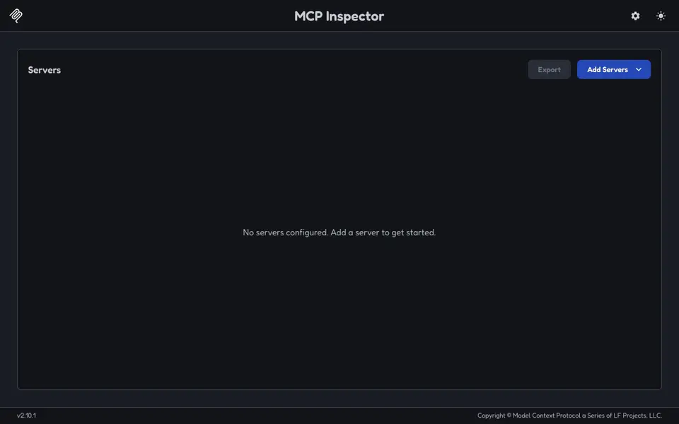
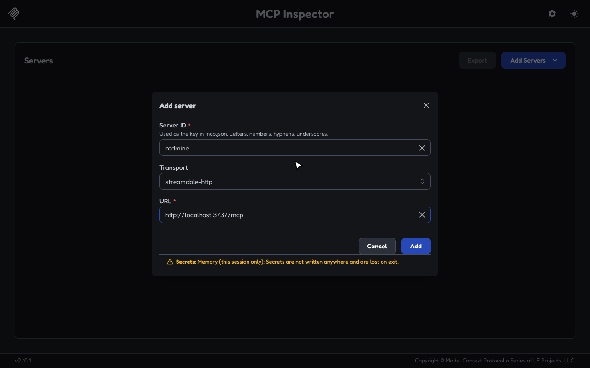
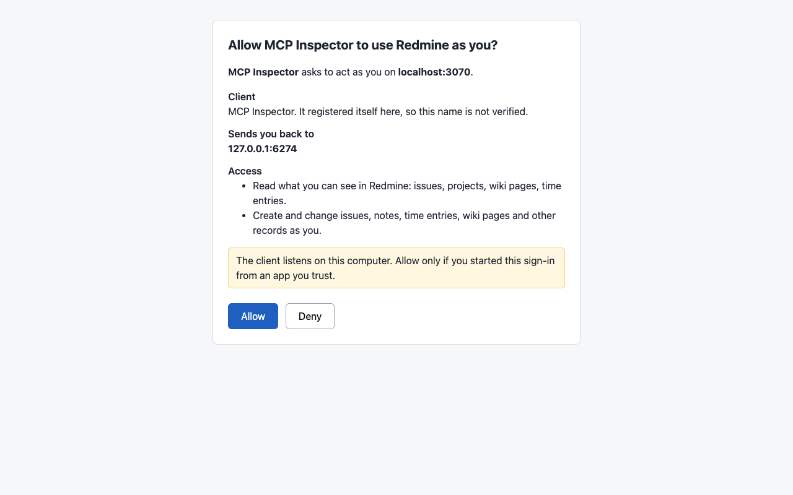
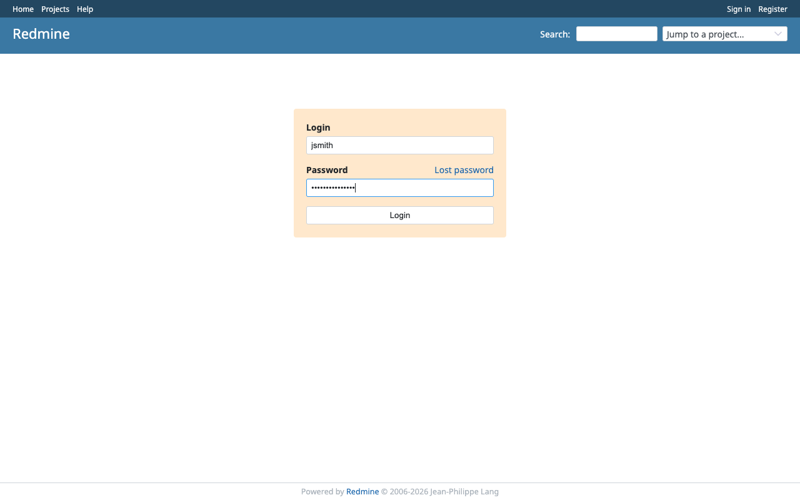
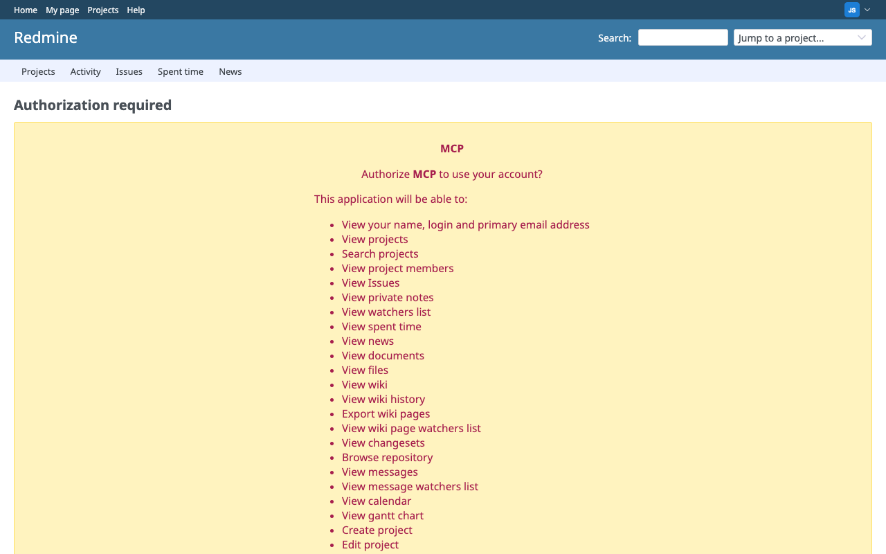
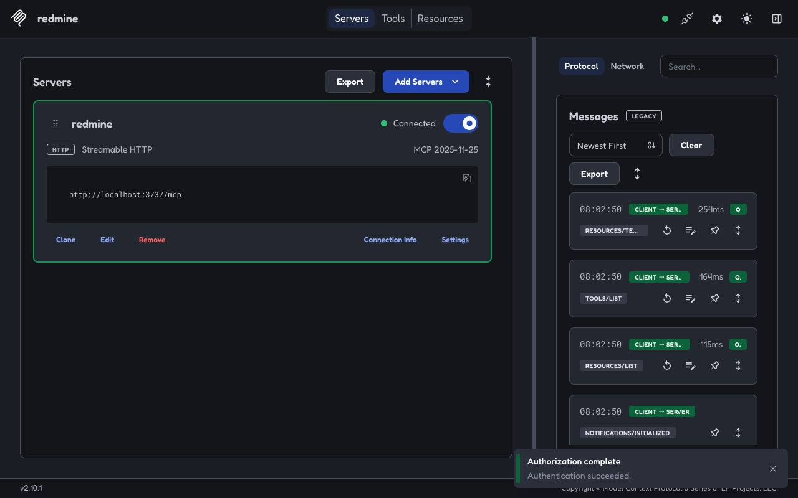
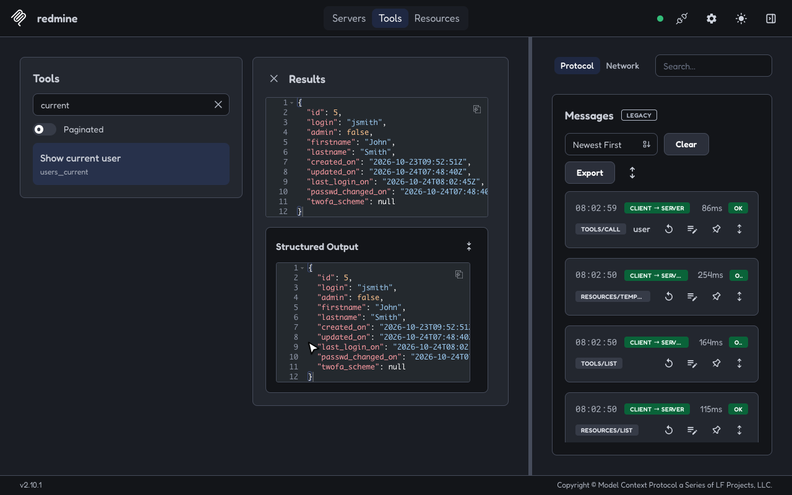

# Run a shared server for claude.ai and ChatGPT

One server at a public https URL can serve everyone in a team. Each person signs in with their own Redmine account, so every tool call runs with that person's Redmine permissions, and Redmine records each change under their name. This guide starts the server, puts TLS in front of it, turns on OAuth, and connects claude.ai and ChatGPT.

## Before you start

- Redmine 6.1 or later with the REST API turned on, under **Administration**, **Settings**, **API**.
- An admin account in Redmine, to create the OAuth application. A Redmine without OAuth applications can use [API key sign-in](authentication.md#api-key-sign-in) instead.
- A host with Node 22 or later that can reach Redmine.
- A public https hostname for the server, such as `mcp.example.com`, and a proxy that terminates TLS, such as Caddy or nginx.

## Start the server

With `--http`, one server serves Streamable HTTP at `/mcp` for many users. Each request carries its user's API key in the `X-Redmine-API-Key` header, and the server answers it with a fresh MCP server for that key. `REDMINE_URL` is fixed at startup, so a client cannot point the server at another host. The server does not read `REDMINE_API_KEY` in this mode. When it is set, the server says once on stderr that it ignores it.

```sh
REDMINE_URL=https://tracker.example.com npx -y @redmine-ts/mcp --http --no-delete
# redmine-mcp: serving MCP at http://127.0.0.1:3737/mcp
```

The line on stderr shows that the server is up. Clients that can send a header can already connect with an API key, as [Connect to a shared server with your key](clients.md#connect-to-a-shared-server-with-your-key) shows. [HTTP server reference](http-server.md) lists how the server answers each kind of request.

## Put TLS in front of the server

The server speaks plain HTTP. Without TLS, the API key crosses the network in clear text, so keep the server on loopback and put a proxy that terminates TLS in front of it. Caddy passes the client's `Host` to the server unless told otherwise. Rewrite it as below, or keep it and start the server with `--allow-host mcp.example.com`:

```caddy
mcp.example.com {
	reverse_proxy 127.0.0.1:3737 {
		header_up Host {upstream_hostport}
	}
}
```

To serve the endpoint on Redmine's own hostname instead, such as `https://tracker.example.com/mcp`, follow [Serve on Redmine's origin](#serve-on-redmines-origin).

## Create the Redmine application

Sign in to Redmine as an admin and create one OAuth application:

1. Administration, Applications, New application.
2. Name: what people see on Redmine's consent page, such as `MCP`.
3. Redirect URI: the public URL of the MCP endpoint followed by `/oauth/redmine/callback`, such as `https://mcp.example.com/mcp/oauth/redmine/callback`. The server prints it at startup. Redmine allows plain http only for `localhost` and `127.0.0.1`.
4. Confidential: keep it checked. Redmine creates only confidential applications.
5. Scopes: tick every permission. The server asks Redmine only for the permissions of the scopes a client was granted (see [Scopes and access modes](authentication.md#scopes-and-access-modes)), and Redmine refuses a request for one the application lacks. Leave Administration unticked; the server never asks for it.
6. Save, and copy the UID into `REDMINE_OAUTH_CLIENT_ID` and the secret into `REDMINE_OAUTH_CLIENT_SECRET`. Redmine shows the secret once.

## Turn on OAuth

1. Generate a secret once, and store it where the server reads its environment:

   ```sh
   openssl rand -base64 32
   ```

   Keep the secret. A new one signs every client out. It must be random, not a passphrase, as [The secret](authentication.md#the-secret) explains.

2. Restart the server with OAuth. `REDMINE_MCP_PUBLIC_URL` is the URL people give their client. `--allow-client` admits only the clients on the listed hosts, which a public server needs, as [Choose which clients may sign in](authentication.md#choose-which-clients-may-sign-in) explains:

   ```sh
   REDMINE_URL=https://tracker.example.com \
   REDMINE_MCP_PUBLIC_URL=https://mcp.example.com/mcp \
   REDMINE_MCP_AUTH_SECRET=... \
   REDMINE_OAUTH_CLIENT_ID=... REDMINE_OAUTH_CLIENT_SECRET=... \
     npx -y @redmine-ts/mcp --http --no-delete --allow-client claude.ai --allow-client chatgpt.com
   # redmine-mcp: serving MCP at http://127.0.0.1:3737/mcp
   # redmine-mcp: OAuth for https://mcp.example.com/mcp; the Redmine application's redirect URI is https://mcp.example.com/mcp/oauth/redmine/callback
   ```

   The second line shows that OAuth is on. Its redirect URI must match the one in the Redmine application. [MCP server settings](configuration.md#oauth-settings) lists every OAuth setting.

The `X-Redmine-API-Key` header keeps working next to OAuth, for clients that can send it.

## Connect claude.ai and ChatGPT

Give each client the public URL, `https://mcp.example.com/mcp`. The client finds everything else from the server's answer.

- In claude.ai, add a custom connector with the URL, and keep the sign-in options it detects.
- In ChatGPT, turn on developer mode and create a connector with the URL and OAuth.

Each person then allows the client on the server's consent page, signs in to Redmine, and approves Redmine's own consent page. The sign-in worked when the client lists the tools and `users_current` returns the person who signed in. From then on, every tool call acts as that person.

## What a sign-in looks like

Here MCP Inspector signs in to a Redmine 7.0. The server runs as in [Turn on OAuth](#turn-on-oauth), with `REDMINE_MCP_PUBLIC_URL=http://localhost:3737/mcp`, `--no-delete`, and `--allow-origin http://127.0.0.1:6274` for the Inspector's page, and without `--allow-client`:

<!-- Recorded by scripts/oauth-walkthrough/record.sh. Run it again after a change to these pages. -->



<details>
<summary>Step by step</summary>

1. The client gets the server's URL and nothing else.

   

2. The server's consent page names the client, where it sends the person back, and the access it asks for: read and write, since the server runs with `--no-delete`.

   

3. Allow leads to Redmine's own login.

   

4. Redmine asks the person to authorize the application the admin created, listing the permissions the server asked for. Redmine skips this page when the person has already authorized the application for the same permissions and has not revoked it; the server's consent page still comes first.

   

5. Redmine sends the browser back through the server, and the client is connected.

   

6. Tools act as the person who signed in: `users_current` returns jsmith.

   

</details>

## Serve on Redmine's origin

The server can share an origin with Redmine, such as `https://tracker.example.com/mcp` next to Redmine at `https://tracker.example.com`, or `https://example.com/redmine/mcp` next to Redmine at `https://example.com/redmine`. Run it on loopback, set `REDMINE_MCP_PUBLIC_URL` to that URL, `REDMINE_URL` to Redmine's internal address and `REDMINE_PUBLIC_URL` to Redmine's public one, and forward these paths unchanged, here for `/mcp`:

- `/mcp` and everything under `/mcp/`
- `/.well-known/oauth-protected-resource/mcp`
- `/.well-known/oauth-authorization-server/mcp`
- `/.well-known/openid-configuration/mcp`

Nothing else at the origin's root belongs to the server. Forward the request body unbuffered and the response as it streams, since tool results arrive as server-sent events.

The browser sends the server Redmine's cookies too, since they share the origin. The server reads only its own cookie, `__Host-redmine-mcp-oauth`, and never passes cookies on, but the proxy can keep Redmine's session cookie from reaching it at all. nginx:

```nginx
# Only the MCP server's own cookie; an empty value drops the header.
map $http_cookie $redmine_mcp_cookie {
    default "";
    "~(?:^|;\s*)(?<mcp>__Host-redmine-mcp-oauth=[^;]+)" $mcp;
}

server {
    server_name tracker.example.com;
    # ... Redmine as before ...

    location ~ ^/(mcp|\.well-known/(oauth-protected-resource|oauth-authorization-server|openid-configuration)/mcp)(/|$) {
        proxy_pass http://127.0.0.1:3737;
        proxy_http_version 1.1;
        proxy_set_header Cookie $redmine_mcp_cookie;
        proxy_request_buffering off;
        proxy_buffering off;
        client_max_body_size 7m;
        client_body_timeout 60s;
    }
}
```

nginx refuses a body over 1 MB with 413 unless `client_max_body_size` raises it, and the server takes up to about 6.7 MiB, enough for a 5 MB upload in base64. `client_body_timeout` ends a request whose body stops arriving for that long, 60 seconds by default, with 408. It applies to every client, including one whose key Redmine accepts. The server itself ends any body still arriving 300 seconds after it began reading it, and a stalled body sooner when another request needs the room it holds in the body budget (see [Security defaults](http-server.md#security-defaults)).

Caddy:

```caddy
tracker.example.com {
	@mcp path /mcp /mcp/* /.well-known/oauth-protected-resource/mcp /.well-known/oauth-authorization-server/mcp /.well-known/openid-configuration/mcp
	handle @mcp {
		reverse_proxy 127.0.0.1:3737 {
			header_up Cookie "__Host-redmine-mcp-oauth={cookie.__Host-redmine-mcp-oauth}"
		}
	}
	handle {
		reverse_proxy 127.0.0.1:3000
	}
}
```

For a subpath, replace `/mcp` with the whole path, such as `/redmine/mcp` and `/.well-known/oauth-protected-resource/redmine/mcp`. The OAuth paths never collide with Redmine's own `/oauth/...` routes, because they all live under the MCP endpoint's path.

Pages on the public origin, the consent page and, on a shared origin, Redmine's own, may call `/mcp` without `--allow-origin`; they still need a key or a token. The consent form is refused when a browser says it was posted from any other origin.

## Related pages

- [OAuth sign-in](authentication.md) covers scopes, the clients that may sign in, sign-out and revocation, changing the secret, and the grant store.
- [MCP server settings](configuration.md) lists every flag and environment variable.
- [HTTP server reference](http-server.md) lists the answers, the limits, and CORS.
- [Embed the server](embedding.md) runs the same server inside Node, Bun, or Cloudflare Workers.
